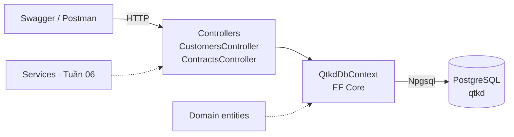

# Thành phần chính của solution (Tuần 05)



```mermaid
erDiagram
    Customer ||--o{ Contract : "có"
    PriceList ||--|{ PriceItem : "gồm"
    Customer { guid Id PK  string Name  string Status }
    Contract { guid Id PK  string ContractNo  guid CustomerId FK  date StartDate  date EndDate  string Status }
    PriceList { guid Id PK  string Name  date EffectiveDate }
    PriceItem { guid PriceListId PK_FK  string ServiceCode PK  decimal UnitPrice }
```
